# JungleAttackClient

## jungleattack.cliente.aplicacion

### AplicacionCliente

- Métodos: main(String[] args)

Punto de entrada del cliente. Dentro del hilo de eventos de Swing crea el modelo, la conexión, el controlador y la ventana principal, y muestra la ventana.

### ConfiguracionCliente

- Atributos estáticos: String HOST_SERVIDOR, int PUERTO_SERVIDOR

Contiene los datos de conexión con el servidor (localhost y el puerto 5001 por defecto).

## jungleattack.cliente.red

### ConexionServidor

- Atributos: socket: Socket, conectado: boolean, emisor: EmisorMensajes, receptor: ReceptorMensajes
- Métodos: conexion(destino: Consumer<Mensaje>), envioMensaje(mensaje), consultaConectado(), cierre()

Abre el socket con el servidor y crea el emisor y el receptor. El receptor se ejecuta en su propio hilo (un hilo daemon), separado del hilo de la interfaz. conexion puede tardar si el servidor no responde, por eso no se llama desde el hilo de la interfaz. El socket se cierra siempre en cierre().

### EmisorMensajes

- Atributos: salida: PrintWriter
- Métodos: envioMensaje(mensaje: Mensaje)

Envía cada mensaje al servidor como un objeto JSON en una línea. Es sincronizado para que no se mezclen los mensajes.

### ReceptorMensajes

- Atributos: entrada: BufferedReader, destino: Consumer<Mensaje>, activo: boolean
- Métodos: recepcionMensajes(), cierre()

El receptor procesa cada mensaje recibido de manera independiente y lo entrega al componente encargado de interpretar las actualizaciones del servidor. Si el servidor envía algo que no es un mensaje válido, lo ignora. Si la conexión se pierde sin que el cliente la haya cerrado, entrega un mensaje interno DISCONNECT para que la interfaz avise al jugador.

## jungleattack.cliente.protocolo

### Mensaje

- Atributos: tipo: String, contenido: String
- Métodos: consultaTipo(), consultaContenido()

Cada instancia representa un mensaje individual. Los datos de un mensaje no se almacenan en un atributo compartido entre diferentes mensajes. El contenido son los datos escritos como texto JSON.

### ConversorMensajes

- Métodos estáticos: conversionDesdeJson(json: String), conversionAJson(mensaje: Mensaje), creacionMensaje(tipo, camposYValores...), campoDelContenido(mensaje, campo), contenidoComoObjeto(mensaje)

Se encarga de convertir los mensajes entre JSON y los objetos utilizados por el cliente. Usa Gson, así que el JSON nunca se arma concatenando textos. Los nombres de los tipos y de los campos están en common.constantes.ConstantesProtocolo.

## jungleattack.cliente.modelo

### ModeloJuego

- Atributos:
  - fase: FaseCliente
  - jugadorLocal: JugadorLocal
  - mapa: MapaCliente
  - zonaInicial: int
  - zonaObservada: int
  - zonasVisibles: List<ZonaVisible>
  - animalesVisibles: List<AnimalVisible>
  - animalesSeleccionados: List<String>
  - tazasVisibles: List<TazaVisible>
  - banderasVisibles: List<BanderaVisible>
  - danio: int
  - tazasConsumidas: int
  - botsEliminados: int
  - efectos: List<EfectoCombate>
  - especiesDisponibles: List<Especie>
  - especieOponente: Especie
  - seleccionCompleta: boolean
  - error: String
  - resumen: ResumenVisible
  - observadores: List<ObservadorModelo>

- Métodos:
  - actualizacionEstado(fase)
  - actualizacionError(motivo)
  - actualizacionSeleccion(disponibles, propia, oponente, completa)
  - actualizacionInicio(mapa, zonaInicial, danio, idsZonasVisibles, animales, tazas, banderas)
  - actualizacionEstadoVisible(danio, idsZonasVisibles, animales, tazas, banderas)
  - actualizacionAnimalesSeleccionados(identificadores)
  - actualizacionZonaObservada(identificadorZona)
  - actualizacionBotsEliminados(botsEliminados)
  - actualizacionTazasConsumidas(tazasConsumidas)
  - actualizacionEfectos(nuevos)
  - actualizacionResumen(resumen)
  - reinicioPartida()
  - limpiezaError()
  - registroObservador(observador)
  - notificacionObservadores()
  - Métodos de consulta (consultaFase(), consultaAnimalesEnZonaObservada(), consultaAnimalesSeleccionados(), consultaZonasVisibles(), consultaEfectosActivos(ahora), entre otros)

Mantiene los datos que necesita la interfaz para representar la partida. Recibe las actualizaciones procesadas por el cliente y notifica a los observadores cuando cambia la información que deben mostrar.

El modelo del cliente representa el estado conocido por el jugador. El estado definitivo de la partida lo mantiene el servidor. Cada STATE_UPDATE reemplaza lo que el jugador ve por la última foto del servidor, conservando la posición dibujada de los animales que ya se conocían para que el movimiento se vea fluido. Solo se puede mirar una zona que el jugador tenga visible; si la zona que se miraba deja de ser visible, se pasa a mirar otra.

### ObservadorModelo — interfaz

- Métodos: actualizacionModelo()

Define el comportamiento de los componentes que necesitan recibir notificaciones cuando cambia el modelo.

### FaseCliente — enum

- Valores: INICIO, ESPERA, SELECCION, JUEGO, RESUMEN

Representa las fases de la aplicación del cliente. Cada fase tiene su pantalla.

### JugadorLocal

- Atributos: apodo: String, especie: Especie, codigoPartida: String
- Métodos: reinicio(), y métodos de consulta y actualización de cada atributo

Representa al jugador local y la información necesaria para participar en la partida.

### AnimalVisible — hereda de common.model.Animal

- Atributos: propio: boolean, bot: boolean, energiaMaxima: int, visualX: double, visualY: double
- Métodos: actualizacionDesdeServidor(energia, posicion), actualizacionVisual(milisegundos), reinicioPosicionVisual(), consultaVisualX(), consultaVisualY(), consultaPropio(), consultaBot(), consultaEnergiaMaxima()

Representa visualmente un animal conocido por el cliente. Reutiliza los atributos y comportamientos comunes definidos en common.model.Animal. La posición real es la que envía el servidor; la posición con la que se dibuja se acerca poco a poco a ella en cada cuadro de la animación. La energía máxima se usa para dibujar la barra de energía.

### ElementoVisible — clase abstracta

- Atributos: posicion: PuntoVisible, zona: int
- Métodos: actualizacionPosicion(posicion), consultaPosicion(), consultaZona()

Representa un objeto del mapa que el cliente tiene permitido visualizar y la zona donde está.

### TazaVisible — hereda de ElementoVisible

- Atributos: identificador: String, consumida: boolean
- Métodos: consultaIdentificador(), consultaConsumida()

### BanderaVisible — hereda de ElementoVisible

- Atributos: propia: boolean
- Métodos: consultaPropia()

Representa una bandera que el cliente tiene permitido visualizar, con un color distinto para la propia y la del oponente.

### ZonaVisible — hereda de common.model.Zona

- Atributos adicionales: nombre: String, poligono: List<PuntoVisible>, posicionEtiqueta: PuntoVisible, anclajeEtiqueta: String
- Métodos: consultaNombre(), consultaPoligono(), consultaPosicionEtiqueta(), consultaAnclajeEtiqueta(), contienePunto(punto)

Reutiliza la información común de una zona y agrega la información necesaria para dibujarla: su nombre, el polígono que la delimita y dónde se escribe su nombre. Las conexiones con otras zonas se heredan de common.model.Zona.

El cliente solo recibe y muestra el contenido de las zonas autorizadas por el servidor.

### CaminoVisible — hereda de common.model.Camino

Representa un camino visible en el mapa.

### PuntoVisible — hereda de common.model.Punto

Representa un punto utilizado para dibujar elementos y realizar conversiones de coordenadas.

### MapaCliente

- Atributos: zonas: List<ZonaVisible>, caminos: List<CaminoVisible>, ancho: int, alto: int
- Métodos: cargaDesdeRecurso() (estático), cargaDesdeLector(lector) (estático), zonaPorIdentificador(identificador), zonaPorPosicion(posicion), consultaZonas(), consultaCaminos(), consultaAncho(), consultaAlto()

Contiene la geometría del mapa que el cliente necesita para dibujar y para saber en qué zona cae un clic. La lee de mapa.json, que está en common. El mapa solo contiene las formas de las zonas y los caminos: lo que hay dentro de cada zona (animales, tazas y banderas) lo envía el servidor y solo para las zonas que el jugador ve.

### EfectoCombate

- Atributos: muerte: boolean, especie: Especie, objetivo: String, x: int, y: int, inicio: long
- Métodos: consultaMuerte(), consultaEspecie(), consultaObjetivo(), consultaX(), consultaY(), consultaInicio()

Representa un efecto visual de un ataque o de una muerte que se dibuja durante un breve tiempo sobre el animal atacado.

### ResumenVisible

- Atributos: victoria: boolean, razon: String, ganador: String, duracion: int, propio: EstadisticasVisibles, oponente: EstadisticasVisibles
- Métodos: consultaVictoria(), consultaRazon(), consultaGanador(), consultaDuracion(), consultaPropio(), consultaOponente()

Representa el resumen final que recibe el cliente cuando termina la partida.

### EstadisticasVisibles

- Atributos: apodo: String, especie: Especie, botsEliminados: int, animalesPerdidos: int, tazasConsumidas: int
- Métodos: métodos de consulta de cada atributo

Contiene las estadísticas de un jugador (bots eliminados, animales perdidos y tazas consumidas) que se muestran en el resumen.

## common.model

Este paquete contiene las clases del modelo que comparten el cliente y el servidor. La idea es reutilizar los atributos y comportamientos comunes, evitando mantener dos implementaciones independientes de los mismos objetos.

### Animal

- Atributos comunes: identificador, energía, estado de vida, posición y especie.
- Métodos comunes: actualización de energía, actualización de posición y consulta del estado de vida.

### Zona

- Atributos comunes: identificador, posición y conexiones.
- Métodos comunes: consulta de conexiones y actualización de información de la zona.

### Camino

- Atributos comunes: zona de inicio, zona de destino y longitud.
- Métodos comunes: consulta de los extremos y la longitud del camino.

### Punto

- Atributos comunes: posicionX: int, posicionY: int.
- Métodos: consulta y actualización de coordenadas.

### Especie

Contiene la información común de las 7 especies, como su identificador y los datos descriptivos de su comportamiento: la ruta de su imagen SVG, la forma de ataque (ZARPAZO, MORDISCO, PICOTAZO o LENGUETAZO) y la ruta del SVG de su efecto visual.

El cliente utiliza esa información para representar las especies. Los recursos gráficos y la reproducción de efectos corresponden a la aplicación cliente.

Las clases específicas de cada aplicación pueden heredar de estos modelos cuando necesiten atributos o comportamientos adicionales.

## common.constantes

### ConstantesComunes

- Atributos estáticos: ANIMAL_SPEED: double, ENCOUNTER_RADIUS: double, MAX_PLAYER_ENERGY: int, además de los nombres de los campos de mapa.json

Contiene las constantes que deben tener el mismo valor en el cliente y en el servidor. El radio de encuentro y la velocidad los usa el servidor para calcular los combates y el movimiento. El cliente usa los nombres de los campos para leer mapa.json.

### ConstantesProtocolo

Contiene los tipos de mensaje, los nombres de los campos del JSON y los motivos de error que usan el cliente y el servidor.

## jungleattack.cliente.controlador

### ControladorJuego

- Atributos: modelo: ModeloJuego, conexion: ConexionServidor
- Métodos:
  - creacionPartida(apodo)
  - unionPartida(apodo, codigoPartida)
  - seleccionEspecie(especie)
  - cancelarPartida()
  - seleccionAnimales(animales)
  - ordenMovimiento(animales, destino)
  - ordenAtaque(animales, objetivo)
  - procesamientoActualizacion(mensaje)
  - volverAlInicio()

Interpreta las acciones solicitadas por el usuario y envía los mensajes correspondientes al servidor. También procesa las actualizaciones recibidas para actualizar el modelo del cliente.

El controlador no decide por su cuenta si una orden de movimiento o un ataque son válidos. Esa validación corresponde al servidor. Solo revisa lo básico antes de enviar (por ejemplo, que el apodo y el código no estén vacíos). Seleccionar animales es una acción solo del cliente: no se le avisa al servidor.

La conexión con el servidor se abre cuando el jugador crea o se une a una partida, en un hilo aparte para no congelar la ventana. Los mensajes del servidor llegan por el hilo de red, que no puede tocar Swing: procesamientoActualizacion pasa cada mensaje al hilo de Swing con SwingUtilities.invokeLater, y ahí se actualiza el modelo.

### ControladorRaton — hereda de MouseAdapter

- Atributos: modelo: ModeloJuego, pantallaJuego: PantallaJuego, controladorJuego: ControladorJuego, inicioArrastre: Point, arrastrando: boolean
- Métodos:
  - mousePressed(evento)
  - mouseDragged(evento)
  - mouseReleased(evento)
  - seleccion(rectangulo, agregar)
  - clic(punto, agregar)
  - seleccionDestino(punto)
  - clicDerecho(punto)
  - seleccionObjetivo(punto)

Recibe los eventos del mouse detectados por los componentes de la interfaz y los transforma en acciones del juego. No implementa directamente las reglas de movimiento ni de combate. El juego se controla con el mouse:

- Clic izquierdo sobre un animal propio: lo selecciona (con Ctrl o Shift lo agrega o lo quita de la selección).
- Arrastrar con el botón izquierdo: selecciona los animales propios que quedan dentro del rectángulo.
- Clic izquierdo sobre otra zona que se ve: pasa a mirar esa zona. Este cambio lo hace solo el cliente, con las zonas que ya recibió.
- Clic derecho sobre un animal de otro jugador o un bot: ordena atacarlo con los animales seleccionados.
- Clic derecho en cualquier otro punto: ordena mover los animales seleccionados a ese punto.

Los eventos del mouse se detectan mediante los mecanismos de eventos de Java. El controlador se encarga de interpretar las acciones del usuario y dirigirlas a los métodos correspondientes.

## jungleattack.cliente.vista

### VentanaPrincipal — hereda de JFrame e implementa ObservadorModelo

- Atributos: modelo: ModeloJuego, controlador: ControladorJuego, pantallaActual: PantallaBase, faseMostrada: FaseCliente
- Métodos: cambioPantalla(pantalla), visualizacion(), actualizacionModelo()

Administra la pantalla que se muestra en cada fase de la aplicación. Se registra como observador del modelo: cuando el modelo cambia, muestra el error si lo hay, cambia de pantalla si cambió la fase y, si no, vuelve a dibujar la pantalla actual. Los errores de las órdenes durante la partida se muestran como un aviso breve sobre el mapa para no interrumpir el juego, y los demás errores en una ventana de mensaje.

### PantallaBase — clase abstracta (hereda de JPanel)

- Atributos: conFondo: boolean, capaFondo: Color
- Métodos: dibujo() (abstracto), actualizacionCapaFondo(capa), paintComponent(g)

Define el comportamiento común de las pantallas, entre ellos el fondo con imagen SVG que usan las pantallas del menú.

### PanelTarjeta — hereda de JPanel

Panel con fondo y bordes redondeados que usan las pantallas del menú para agrupar sus elementos.

### EstiloVista

Clase interna del paquete con métodos estáticos para crear los componentes de las pantallas (etiquetas, botones, campos y la imagen de una especie) con el mismo estilo.

### PantallaInicio — hereda de PantallaBase

- Atributos: controlador: ControladorJuego, campoApodo: JTextField, campoCodigo: JTextField
- Métodos: dibujo()

Permite escribir el apodo y elegir entre crear una partida o unirse a una con su código.

### PantallaEspera — hereda de PantallaBase

- Atributos: modelo: ModeloJuego, controlador: ControladorJuego, temporizadorPuntos: Timer
- Métodos: dibujo()

Muestra el código de la partida creada, con un botón para copiarlo y otro para cancelar, mientras se espera al segundo jugador.

### PantallaSeleccion — hereda de PantallaBase

- Atributos: modelo: ModeloJuego, controlador: ControladorJuego
- Métodos: dibujo()

Muestra las 7 especies para que el jugador elija una. Indica cuál es la propia y cuál eligió el oponente, y solo permite pulsar las que siguen libres mientras el jugador no ha elegido.

### PantallaJuego — hereda de PantallaBase e implementa ObservadorModelo

- Atributos: modelo: ModeloJuego, conversor: ConversorCoordenadas, temporizadorAnimacion: Timer, ultimoCuadro: long, rectanguloSeleccion: Rectangle, aviso: String
- Métodos:
  - dibujo()
  - actualizacionAnimacion()
  - actualizacionModelo()
  - consultaConversor()
  - actualizacionRectanguloSeleccion(rectangulo)
  - mostrarAviso(texto)

Representa visualmente el estado conocido de la partida: el mapa, la niebla sobre las zonas que el jugador no ve, el contenido de la zona que está mirando (animales con su barra de energía y su anillo de color, tazas y banderas), los efectos de combate, el rectángulo de selección y un panel con la zona actual, el daño, las tazas consumidas, los bots eliminados y los animales seleccionados. Utiliza un temporizador de Java (javax.swing.Timer) para actualizar la animación sin bloquear la interfaz; el temporizador solo corre mientras la pantalla está dentro de la ventana. Crea su ControladorRaton.

La animación permite representar de manera fluida los desplazamientos comunicados por el servidor. No determina la posición definitiva de los animales ni resuelve las reglas de movimiento o combate.

### PantallaResumen — hereda de PantallaBase

- Atributos: modelo: ModeloJuego, controlador: ControladorJuego
- Métodos: dibujo()

Muestra si el jugador ganó o perdió, la razón, la duración de la partida y, para cada jugador, los bots eliminados, los animales perdidos y las tazas consumidas. Tiene un botón para volver al inicio.

### ConversorCoordenadas

- Atributos: escala: double, desplazamientoX: double, desplazamientoY: double
- Métodos: actualizacionVentana(anchoPanel, altoPanel, anchoMapa, altoMapa), conversionPantallaAMapa(punto), conversionMapaAPantalla(punto), consultaEscala()

Convierte las coordenadas de la interfaz en coordenadas del mapa y viceversa. El mapa se agranda o se achica para caber en el panel sin deformarse y queda centrado.

## jungleattack.cliente.recursos

### CacheImagenes

- Atributos estáticos: imagenes: Map<String, Image>
- Métodos estáticos: cargaImagen(nombre, ruta, ancho, alto), imagenPorNombre(nombre), imagenDeEspecie(especie), imagenDeEspecie(especie, tamano), imagenDeRecurso(nombre, ruta, ancho, alto)

Administra las imágenes cargadas para evitar cargar repetidamente los mismos recursos. Todas las imágenes del juego son SVG. Como Java no dibuja SVG por sí solo, se usa la librería JSVG: cada SVG se convierte una sola vez en una imagen (BufferedImage) y esa imagen se guarda en la caché. El SVG nunca se interpreta en cada cuadro de la animación. Si un SVG no existe o está dañado, esa imagen simplemente no se muestra y el juego sigue funcionando.

## jungleattack.cliente.constantes

### ConstantesCliente

- Atributos estáticos:
  - ANCHO_VENTANA: int
  - ALTO_VENTANA: int
  - INTERVALO_ANIMACION: int
  - TIEMPO_SUAVIZADO_MS: int
  - RADIO_CLIC_ANIMAL: int
  - DISTANCIA_MINIMA_ARRASTRE: int
  - DURACION_EFECTO_MS: int
  - DURACION_AVISO_MS: int
  - Rutas y nombres de las imágenes del mapa, las banderas, las tazas y el fondo
  - Tamaños, grosores y colores del dibujo del mapa y de las pantallas
  - Textos de las pantallas y de los mensajes de error

Contiene las constantes utilizadas por la interfaz y la representación visual, de modo que no haya valores fijos dentro de las clases. Las reglas definitivas de combate y alcance corresponden al servidor. El radio de encuentro (ENCOUNTER_RADIUS) se define en ConstantesComunes, en common.

## Herencia, interfaces y polimorfismo

- common.model.Animal es la clase común de AnimalVisible.
- common.model.Zona es la clase común de ZonaVisible.
- common.model.Camino es la clase común de CaminoVisible.
- common.model.Punto es la clase común de PuntoVisible.
- ElementoVisible es la clase abstracta de TazaVisible y BanderaVisible.
- PantallaBase es la clase abstracta de PantallaInicio, PantallaEspera, PantallaSeleccion, PantallaJuego y PantallaResumen.
- PantallaJuego y VentanaPrincipal implementan la interfaz ObservadorModelo.
- ControladorRaton hereda de MouseAdapter y PanelTarjeta hereda de JPanel.
- El polimorfismo permite trabajar con las diferentes pantallas mediante PantallaBase y con los modelos compartidos mediante sus clases comunes.

## Elementos estáticos

- ConfiguracionCliente contiene los datos de conexión con el servidor.
- CacheImagenes comparte las imágenes cargadas mediante atributos y métodos estáticos.
- ConstantesCliente contiene las constantes de la interfaz y la animación.
- ConversorMensajes contiene métodos estáticos para convertir mensajes.
- MapaCliente.cargaDesdeRecurso() y EstiloVista contienen métodos estáticos.
- ConstantesComunes y ConstantesProtocolo, en common, contienen las constantes compartidas con el servidor.

## Patrones de diseño

### MVC

- Modelo: ModeloJuego y las clases del modelo.
- Vista: VentanaPrincipal y las clases Pantalla.
- Controlador: ControladorJuego y ControladorRaton.

La vista representa la información del modelo y los controladores procesan las acciones del usuario. La vista solo dibuja: no contiene lógica del juego.

### Observer

- Sujeto: ModeloJuego.
- Interfaz observadora: ObservadorModelo.
- Observador concreto: VentanaPrincipal, que se registra en el modelo y vuelve a dibujar la pantalla actual (PantallaJuego incluida) cuando el modelo cambia.

ModeloJuego mantiene los observadores registrados y los notifica cuando cambia la información que deben mostrar.

## Comunicación y actualización de la partida

El servidor es la autoridad sobre el estado real de la partida. El cliente envía las acciones del jugador y recibe mensajes con las actualizaciones correspondientes. Los dos clientes nunca se comunican directamente: todos los mensajes pasan por el servidor.

La secuencia general es:

1. El usuario selecciona animales y solicita una acción mediante la interfaz.
2. Los controladores interpretan la acción y preparan el mensaje correspondiente.
3. EmisorMensajes envía el mensaje al servidor.
4. El servidor valida la orden y actualiza el estado de la partida.
5. El servidor comunica las actualizaciones a los clientes correspondientes.
6. ReceptorMensajes recibe los mensajes (en un hilo aparte) y ConversorMensajes los convierte en objetos.
7. ControladorJuego pasa cada mensaje al hilo de Swing, procesa las actualizaciones y modifica ModeloJuego.
8. ModeloJuego notifica a sus observadores.
9. La pantalla actualiza la representación visual mediante el temporizador de animación.

Para representar los movimientos, el cliente interpola visualmente las posiciones entre los datos recibidos: la posición dibujada de cada animal se acerca a la posición real que informó el servidor en cada cuadro. El servidor conserva la autoridad sobre las posiciones reales, los combates, la energía, las muertes, el consumo de objetos y la victoria.

El servidor también determina qué zonas y elementos puede visualizar cada jugador. El cliente no debe mostrar información de zonas que no haya recibido. Las zonas donde el jugador no tiene animales se dibujan cubiertas por niebla.

## Mensajes del protocolo

- Cliente → Servidor: CREATE_MATCH (apodo), JOIN_MATCH (apodo y código), SELECT_ANIMAL (especie), MOVE_ANIMALS (animales y destino) y ATTACK (animales y objetivo).
- Servidor → Cliente: MATCH_CREATED, MATCH_JOINED, ANIMAL_SELECTION, GAME_STARTED, STATE_UPDATE, GAME_OVER y ERROR.

El cliente no envía VIEW_ZONE: como el servidor ya le envía todas las zonas que puede ver, cambiar la zona que está mirando es una acción local.

## Desconexión

- Si el cliente no logra conectarse, muestra el error de falta de conexión y se queda en la pantalla de inicio.
- Si el jugador cancela la espera, se cierra la conexión y se vuelve al inicio; el servidor cancela la partida.
- Si se pierde la conexión con el servidor, se cierra el socket, se reinicia el modelo y se vuelve al inicio con un aviso.
- Si el oponente se desconecta antes de empezar la partida, el servidor la cancela y el cliente vuelve al inicio con un aviso. Si se desconecta durante la partida, el jugador que se queda gana y ve el resumen.

## Pruebas unitarias

Las pruebas están en src/test/java, con la misma estructura de paquetes, y se ejecutan con mvn test (JUnit 5).

- jungleattack.cliente.modelo: ModeloJuegoInicioTest, ModeloJuegoEstadoTest, AnimalVisibleTest, MapaClienteTest
- jungleattack.cliente.controlador: ControladorJuegoTest, ControladorJuegoConexionTest, ControladorJuegoMovimientoTest, ControladorRatonTest
- jungleattack.cliente.protocolo: ConversorMensajesTest
- jungleattack.cliente.vista: ConversorCoordenadasTest, PantallaInicioTest, PantallaEsperaTest, PantallaJuegoTest, PantallaResumenTest

El flujo .github/workflows/tests.yml descarga este repositorio y el de JungleAttackCommon, instala common y ejecuta mvn clean verify en cada push y pull request (Java 21).

## Diagrama de clases

```mermaid
classDiagram
    class AplicacionCliente {
        +main(String[] args)
    }

    class ConfiguracionCliente {
        +HOST_SERVIDOR: String$
        +PUERTO_SERVIDOR: int$
    }

    class ConexionServidor {
        -socket: Socket
        -conectado: boolean
        -emisor: EmisorMensajes
        -receptor: ReceptorMensajes
        +conexion(destino)
        +envioMensaje(mensaje)
        +consultaConectado()
        +cierre()
    }

    class EmisorMensajes {
        -salida: PrintWriter
        +envioMensaje(mensaje)
    }

    class ReceptorMensajes {
        -entrada: BufferedReader
        -destino: Consumer~Mensaje~
        -activo: boolean
        +recepcionMensajes()
        +cierre()
    }

    AplicacionCliente --> ConexionServidor
    AplicacionCliente --> ControladorJuego
    AplicacionCliente --> VentanaPrincipal
    ConexionServidor --> EmisorMensajes
    ConexionServidor --> ReceptorMensajes
    ConexionServidor ..> ConfiguracionCliente

    class Mensaje {
        -tipo: String
        -contenido: String
        +consultaTipo()
        +consultaContenido()
    }

    class ConversorMensajes {
        +conversionDesdeJson(json)$
        +conversionAJson(mensaje)$
        +creacionMensaje(tipo, camposYValores)$
        +campoDelContenido(mensaje, campo)$
        +contenidoComoObjeto(mensaje)$
    }

    EmisorMensajes --> Mensaje
    ReceptorMensajes --> Mensaje
    ConversorMensajes ..> Mensaje

    class ModeloJuego {
        -fase: FaseCliente
        -jugadorLocal: JugadorLocal
        -mapa: MapaCliente
        -zonaInicial: int
        -zonaObservada: int
        -zonasVisibles: List~ZonaVisible~
        -animalesVisibles: List~AnimalVisible~
        -animalesSeleccionados: List~String~
        -tazasVisibles: List~TazaVisible~
        -banderasVisibles: List~BanderaVisible~
        -danio: int
        -tazasConsumidas: int
        -botsEliminados: int
        -efectos: List~EfectoCombate~
        -especiesDisponibles: List~Especie~
        -especieOponente: Especie
        -seleccionCompleta: boolean
        -error: String
        -resumen: ResumenVisible
        -observadores: List~ObservadorModelo~
        +actualizacionEstado(fase)
        +actualizacionError(motivo)
        +actualizacionSeleccion(disponibles, propia, oponente, completa)
        +actualizacionInicio(mapa, zonaInicial, danio, idsZonasVisibles, animales, tazas, banderas)
        +actualizacionEstadoVisible(danio, idsZonasVisibles, animales, tazas, banderas)
        +actualizacionAnimalesSeleccionados(identificadores)
        +actualizacionZonaObservada(identificadorZona)
        +actualizacionEfectos(nuevos)
        +actualizacionResumen(resumen)
        +reinicioPartida()
        +limpiezaError()
        +registroObservador(observador)
        +notificacionObservadores()
    }

    class ObservadorModelo {
        <<interface>>
        +actualizacionModelo()
    }

    class FaseCliente {
        <<enumeration>>
        INICIO
        ESPERA
        SELECCION
        JUEGO
        RESUMEN
    }

    class JugadorLocal {
        -apodo: String
        -especie: Especie
        -codigoPartida: String
        +reinicio()
    }

    ModeloJuego --> FaseCliente
    ModeloJuego --> JugadorLocal
    ModeloJuego --> MapaCliente
    ModeloJuego --> ZonaVisible
    ModeloJuego --> AnimalVisible
    ModeloJuego --> TazaVisible
    ModeloJuego --> BanderaVisible
    ModeloJuego --> EfectoCombate
    ModeloJuego --> ResumenVisible
    ModeloJuego o-- ObservadorModelo

    class Punto {
        -posicionX: int
        -posicionY: int
    }

    class Camino {
        -inicio: Zona
        -destino: Zona
        -longitud: double
    }

    class Zona {
        -identificador: int
        -posicion: Punto
        -conexiones: List~Camino~
    }

    class Animal {
        -identificador: String
        -energia: int
        -vivo: boolean
        -posicion: Punto
        -especie: Especie
    }

    class Especie {
        <<enumeration>>
    }

    class AnimalVisible {
        -propio: boolean
        -bot: boolean
        -energiaMaxima: int
        -visualX: double
        -visualY: double
        +actualizacionDesdeServidor(energia, posicion)
        +actualizacionVisual(milisegundos)
        +reinicioPosicionVisual()
    }

    class ZonaVisible {
        -nombre: String
        -poligono: List~PuntoVisible~
        -posicionEtiqueta: PuntoVisible
        -anclajeEtiqueta: String
        +contienePunto(punto)
    }

    class CaminoVisible

    class PuntoVisible

    class MapaCliente {
        -zonas: List~ZonaVisible~
        -caminos: List~CaminoVisible~
        -ancho: int
        -alto: int
        +cargaDesdeRecurso()$
        +cargaDesdeLector(lector)$
        +zonaPorIdentificador(identificador)
        +zonaPorPosicion(posicion)
    }

    class ElementoVisible {
        <<abstract>>
        -posicion: PuntoVisible
        -zona: int
        +actualizacionPosicion(posicion)
    }

    class TazaVisible {
        -identificador: String
        -consumida: boolean
    }

    class BanderaVisible {
        -propia: boolean
    }

    class EfectoCombate {
        -muerte: boolean
        -especie: Especie
        -objetivo: String
        -x: int
        -y: int
        -inicio: long
    }

    class ResumenVisible {
        -victoria: boolean
        -razon: String
        -ganador: String
        -duracion: int
        -propio: EstadisticasVisibles
        -oponente: EstadisticasVisibles
    }

    class EstadisticasVisibles {
        -apodo: String
        -especie: Especie
        -botsEliminados: int
        -animalesPerdidos: int
        -tazasConsumidas: int
    }

    Animal <|-- AnimalVisible
    Zona <|-- ZonaVisible
    Camino <|-- CaminoVisible
    Punto <|-- PuntoVisible

    ElementoVisible <|-- TazaVisible
    ElementoVisible <|-- BanderaVisible

    Animal --> Especie
    Animal --> Punto
    Zona --> Punto
    Zona --> Camino
    Camino --> Zona
    JugadorLocal --> Especie
    ElementoVisible --> PuntoVisible
    MapaCliente o-- ZonaVisible
    MapaCliente o-- CaminoVisible
    EfectoCombate --> Especie
    ResumenVisible --> EstadisticasVisibles

    class ControladorJuego {
        -modelo: ModeloJuego
        -conexion: ConexionServidor
        +creacionPartida(apodo)
        +unionPartida(apodo, codigoPartida)
        +seleccionEspecie(especie)
        +cancelarPartida()
        +seleccionAnimales(animales)
        +ordenMovimiento(animales, destino)
        +ordenAtaque(animales, objetivo)
        +procesamientoActualizacion(mensaje)
        +volverAlInicio()
    }

    class ControladorRaton {
        -modelo: ModeloJuego
        -pantallaJuego: PantallaJuego
        -controladorJuego: ControladorJuego
        -inicioArrastre: Point
        -arrastrando: boolean
        +mousePressed(evento)
        +mouseDragged(evento)
        +mouseReleased(evento)
        +seleccion(rectangulo, agregar)
        +clic(punto, agregar)
        +seleccionDestino(punto)
        +clicDerecho(punto)
        +seleccionObjetivo(punto)
    }

    class MouseAdapter {
        <<java.awt.event>>
    }

    MouseAdapter <|-- ControladorRaton
    ControladorJuego --> ModeloJuego
    ControladorJuego --> ConexionServidor
    ControladorJuego ..> Mensaje
    ControladorJuego ..> ConversorMensajes
    ControladorRaton --> ModeloJuego
    ControladorRaton --> ControladorJuego
    ControladorRaton --> PantallaJuego

    class VentanaPrincipal {
        -modelo: ModeloJuego
        -controlador: ControladorJuego
        -pantallaActual: PantallaBase
        -faseMostrada: FaseCliente
        +cambioPantalla(pantalla)
        +visualizacion()
        +actualizacionModelo()
    }

    class PantallaBase {
        <<abstract>>
        -conFondo: boolean
        -capaFondo: Color
        +dibujo()*
        +actualizacionCapaFondo(capa)
    }

    class PanelTarjeta

    class EstiloVista

    class PantallaInicio {
        -controlador: ControladorJuego
        -campoApodo: JTextField
        -campoCodigo: JTextField
        +dibujo()
    }

    class PantallaEspera {
        -modelo: ModeloJuego
        -controlador: ControladorJuego
        -temporizadorPuntos: Timer
        +dibujo()
    }

    class PantallaSeleccion {
        -modelo: ModeloJuego
        -controlador: ControladorJuego
        +dibujo()
    }

    class PantallaJuego {
        -modelo: ModeloJuego
        -conversor: ConversorCoordenadas
        -temporizadorAnimacion: Timer
        -ultimoCuadro: long
        -rectanguloSeleccion: Rectangle
        -aviso: String
        +dibujo()
        +actualizacionAnimacion()
        +actualizacionModelo()
        +consultaConversor()
        +actualizacionRectanguloSeleccion(rectangulo)
        +mostrarAviso(texto)
    }

    class PantallaResumen {
        -modelo: ModeloJuego
        -controlador: ControladorJuego
        +dibujo()
    }

    PantallaBase <|-- PantallaInicio
    PantallaBase <|-- PantallaEspera
    PantallaBase <|-- PantallaSeleccion
    PantallaBase <|-- PantallaJuego
    PantallaBase <|-- PantallaResumen

    ObservadorModelo <|.. PantallaJuego
    ObservadorModelo <|.. VentanaPrincipal
    VentanaPrincipal --> PantallaBase
    VentanaPrincipal --> ModeloJuego
    VentanaPrincipal --> ControladorJuego
    PantallaJuego --> ModeloJuego
    PantallaJuego --> ControladorRaton
    PantallaInicio --> ControladorJuego
    PantallaEspera --> ControladorJuego
    PantallaSeleccion --> ControladorJuego
    PantallaResumen --> ControladorJuego
    PantallaJuego ..> ConstantesCliente
    PantallaJuego ..> ConstantesComunes
    PantallaEspera --> PanelTarjeta
    PantallaResumen --> PanelTarjeta
    PantallaInicio ..> EstiloVista

    class ConversorCoordenadas {
        -escala: double
        -desplazamientoX: double
        -desplazamientoY: double
        +actualizacionVentana(anchoPanel, altoPanel, anchoMapa, altoMapa)
        +conversionPantallaAMapa(punto)
        +conversionMapaAPantalla(punto)
        +consultaEscala()
    }

    PantallaJuego --> ConversorCoordenadas

    class CacheImagenes {
        -imagenes: Map~String,Image~$
        +cargaImagen(nombre, ruta, ancho, alto)$
        +imagenPorNombre(nombre)$
        +imagenDeEspecie(especie)$
        +imagenDeRecurso(nombre, ruta, ancho, alto)$
    }

    class ConstantesCliente {
        +ANCHO_VENTANA: int$
        +ALTO_VENTANA: int$
        +INTERVALO_ANIMACION: int$
        +TIEMPO_SUAVIZADO_MS: int$
        +RADIO_CLIC_ANIMAL: int$
        +DISTANCIA_MINIMA_ARRASTRE: int$
        +DURACION_EFECTO_MS: int$
        +DURACION_AVISO_MS: int$
    }

    class ConstantesComunes {
        <<common.constantes>>
        +ANIMAL_SPEED: double$
        +ENCOUNTER_RADIUS: double$
        +MAX_PLAYER_ENERGY: int$
    }

    PantallaBase ..> CacheImagenes
    PantallaBase ..> ConstantesCliente
    PantallaJuego ..> CacheImagenes
    PantallaSeleccion ..> CacheImagenes
```

