# JungleAttackClient

## Paquetes y clases

### jungleattack.cliente.aplicacion

**AplicacionCliente**

- Métodos: main(String[] args)

**ConfiguracionCliente**

- Atributos estáticos: String HOST_SERVIDOR,  int PUERTO_SERVIDOR

### jungleattack.cliente.red

**ConexionServidor**

- Atributos: socket: Socket, conectado: boolean
- Métodos: conexion(), cierre()

**EmisorMensajes**

- Atributos: salida: PrintWriter
- Métodos: envioMensaje()

**ReceptorMensajes**

- Atributos: entrada: BufferedReader, activo: boolean
- Métodos: recepcionMensajes(), cierre()

### jungleattack.cliente.protocolo

**Mensaje**

- Atributos:tipo: String, contenido: String

**ConversorMensajes**

- Métodos: conversionDesdeJson(), conversionAJson()

### jungleattack.cliente.modelo

**ModeloJuego**

- Atributos:
    
    fase: FaseCliente
    
    jugadorLocal: JugadorLocal
    
    zonasVisibles: List<ZonaVisible>
    
    animalesVisibles: List<AnimalVisible>
    
    tazasVisibles: List<TazaVisible>
    
    banderaVisible: BanderaVisible
    
    resumen: ResumenVisible
    
    observadores: List<ObservadorModelo>
    
- Métodos: actualizacionEstado(), actualizacionZona(), actualizacionResumen(), registroObservador(), notificacionObservadores()

**ObservadorModelo** — interfaz

- Métodos: actualizacionModelo()

**FaseCliente** — enum

**JugadorLocal**

- Atributos: apodo: String, especie: EspecieCliente, codigoPartida: String

**ElementoVisible** — clase abstracta

- Atributos: posicion: PuntoVisible
- Métodos: actualizacionPosicion()

**AnimalVisible** — hereda de ElementoVisible

- Atributos: energia: int, especie: EspecieCliente, propio: boolean, vivo: boolean
- Métodos: actualizacionEnergia(), actualizacionEstado()

**TazaVisible** — hereda de ElementoVisible

- Atributos: consumida: boolean
- Métodos: actualizacionEstado()

**BanderaVisible** — hereda de ElementoVisible

**EspecieCliente** — enum

**ZonaVisible**

- Atributos: identificador: int, posicion: PuntoVisible, conexiones: List<CaminoVisible>

**CaminoVisible**

- Atributos: inicio: PuntoVisible, destino: PuntoVisible, longitud: double

**PuntoVisible**

- Atributos:  posicionX: int, posicionY: int

**ResumenVisible**

- Atributos: botsEliminados: int, animalesEliminados: int, tazasConsumidas: int, duracion: double

### jungleattack.cliente.controlador

**ControladorJuego**

- Atributos: modelo: ModeloJuego, conexion: ConexionServidor
- Métodos: creacionPartida(), unionPartida(), seleccionEspecie(), movimientoAnimales(), ataque(), consultaZona()

**ControladorRaton**

- Atributos:  pantallaJuego: PantallaJuego, controladorJuego: ControladorJuego
- Métodos: seleccion(), movimiento(), clic()

### jungleattack.cliente.vista

**VentanaPrincipal**

- Atributos: pantallaActual: PantallaBase
- Métodos: cambioPantalla(), visualizacion()

**PantallaBase** — clase abstracta

- Métodos: dibujo()

**PantallaInicio** — hereda de PantallaBase

- Métodos: dibujo()

**PantallaEspera** — hereda de PantallaBase

- Métodos: dibujo()

**PantallaSeleccion** — hereda de PantallaBase

- Métodos: dibujo()

**PantallaJuego** — hereda de PantallaBase e implementa ObservadorModelo

- Atributos:  modelo: ModeloJuego, temporizadorAnimacion: Timer
- Métodos: dibujo(), actualizacionAnimacion(), actualizacionModelo()

**PantallaResumen** — hereda de PantallaBase

- Métodos: dibujo()

**ConversorCoordenadas**

- Métodos: conversionPantallaAMapa(), conversionMapaAPantalla()

### jungleattack.cliente.recursos

**CacheImagenes**

- Atributos estáticos:  imagenes: Map<String, Image>
- Métodos estáticos: cargaImagen(), imagenPorNombre()

### jungleattack.cliente.constantes

**ConstantesCliente**

- Atributos estáticos:
    
    ANCHO_VENTANA: int
    
    ALTO_VENTANA: int
    
    VELOCIDAD_MOVIMIENTO: double
    
    INTERVALO_ANIMACION: int
    
    ENCOUNTER_RADIUS: double
    

## Herencia, interfaces y polimorfismo

- ElementoVisible es la clase abstracta de AnimalVisible, TazaVisible y BanderaVisible.
- PantallaBase es la clase abstracta de PantallaInicio, PantallaEspera, PantallaSeleccion, PantallaJuego y PantallaResumen.
- PantallaJuego implementa la interfaz ObservadorModelo.
- El polimorfismo se utiliza al trabajar con diferentes elementos visibles mediante ElementoVisible y con las pantallas mediante PantallaBase.

## Elementos estáticos

- ConfiguracionCliente contiene las constantes de conexión con el servidor.
- CacheImagenes comparte las imágenes cargadas mediante atributos y métodos estáticos.
- ConstantesCliente contiene las constantes de la interfaz y la animación.

## Patrones de diseño

**MVC**

- Modelo: ModeloJuego y las clases del paquete modelo.
- Vista: VentanaPrincipal y las clases Pantalla.
- Controlador: ControladorJuego y ControladorRaton.

**Observer**

- Sujeto: ModeloJuego.
- Interfaz observadora: ObservadorModelo.
- Observador: PantallaJuego.
- ModeloJuego mantiene los observadores registrados y les notifica cuando cambia la información que deben mostrar.

## Diagrama de clases

```mermaid
classDiagram
    class AplicacionCliente {
        +main(String[] args)
    }

    class ConfiguracionCliente {
        +HOST_SERVIDOR: String$
        +PUERTO_SERVIDOR: int$
    }

    class ConexionServidor {
        -socket: Socket
        -conectado: boolean
        +conexion()
        +cierre()
    }

    class EmisorMensajes {
        -salida: PrintWriter
        +envioMensaje()
    }

    class ReceptorMensajes {
        -entrada: BufferedReader
        -activo: boolean
        +recepcionMensajes()
        +cierre()
    }

    AplicacionCliente --> ConexionServidor
    ConexionServidor --> EmisorMensajes
    ConexionServidor --> ReceptorMensajes
    ConexionServidor ..> ConfiguracionCliente

    class Mensaje {
        +tipo: String
        +contenido: String
    }

    class ConversorMensajes {
        +conversionDesdeJson()
        +conversionAJson()
    }

    EmisorMensajes --> Mensaje
    ReceptorMensajes --> Mensaje
    ConversorMensajes ..> Mensaje

    class ModeloJuego {
        -fase: FaseCliente
        -jugadorLocal: JugadorLocal
        -zonasVisibles: List~ZonaVisible~
        -animalesVisibles: List~AnimalVisible~
        -tazasVisibles: List~TazaVisible~
        -banderaVisible: BanderaVisible
        -resumen: ResumenVisible
        -observadores: List~ObservadorModelo~
        +actualizacionEstado()
        +actualizacionZona()
        +actualizacionResumen()
        +registroObservador()
        +notificacionObservadores()
    }

    class ObservadorModelo {
        <<interface>>
        +actualizacionModelo()
    }

    class FaseCliente {
        <<enumeration>>
    }

    class JugadorLocal {
        -apodo: String
        -especie: EspecieCliente
        -codigoPartida: String
    }

    class EspecieCliente {
        <<enumeration>>
    }

    ModeloJuego --> FaseCliente
    ModeloJuego --> JugadorLocal
    ModeloJuego --> ZonaVisible
    ModeloJuego --> AnimalVisible
    ModeloJuego --> TazaVisible
    ModeloJuego --> BanderaVisible
    ModeloJuego --> ResumenVisible
    ModeloJuego o-- ObservadorModelo

    class ElementoVisible {
        <<abstract>>
        -posicion: PuntoVisible
        +actualizacionPosicion()
    }

    class AnimalVisible {
        -energia: int
        -especie: EspecieCliente
        -propio: boolean
        -vivo: boolean
        +actualizacionEnergia()
        +actualizacionEstado()
    }

    class TazaVisible {
        -consumida: boolean
        +actualizacionEstado()
    }

    class BanderaVisible

    ElementoVisible <|-- AnimalVisible
    ElementoVisible <|-- TazaVisible
    ElementoVisible <|-- BanderaVisible
    AnimalVisible --> EspecieCliente

    class ZonaVisible {
        -identificador: int
        -posicion: PuntoVisible
        -conexiones: List~CaminoVisible~
    }

    class CaminoVisible {
        -inicio: PuntoVisible
        -destino: PuntoVisible
        -longitud: double
    }

    class PuntoVisible {
        -posicionX: int
        -posicionY: int
    }

    class ResumenVisible {
        -botsEliminados: int
        -animalesEliminados: int
        -tazasConsumidas: int
        -duracion: double
    }

    ZonaVisible --> PuntoVisible
    ZonaVisible --> CaminoVisible
    CaminoVisible --> PuntoVisible
    ElementoVisible --> PuntoVisible

    class ControladorJuego {
        -modelo: ModeloJuego
        -conexion: ConexionServidor
        +creacionPartida()
        +unionPartida()
        +seleccionEspecie()
        +movimientoAnimales()
        +ataque()
        +consultaZona()
    }

    class ControladorRaton {
        -pantallaJuego: PantallaJuego
        -controladorJuego: ControladorJuego
        +seleccion()
        +movimiento()
        +clic()
    }

    ControladorJuego --> ModeloJuego
    ControladorJuego --> ConexionServidor
    ControladorRaton --> ControladorJuego

    class VentanaPrincipal {
        -pantallaActual: PantallaBase
        +cambioPantalla()
        +visualizacion()
    }

    class PantallaBase {
        <<abstract>>
        +dibujo()
    }

    class PantallaInicio {
        +dibujo()
    }

    class PantallaEspera {
        +dibujo()
    }

    class PantallaSeleccion {
        +dibujo()
    }

    class PantallaJuego {
        -modelo: ModeloJuego
        -temporizadorAnimacion: Timer
        +dibujo()
        +actualizacionAnimacion()
        +actualizacionModelo()
    }

    class PantallaResumen {
        +dibujo()
    }

    PantallaBase <|-- PantallaInicio
    PantallaBase <|-- PantallaEspera
    PantallaBase <|-- PantallaSeleccion
    PantallaBase <|-- PantallaJuego
    PantallaBase <|-- PantallaResumen

    ObservadorModelo <|.. PantallaJuego
    VentanaPrincipal --> PantallaBase
    PantallaJuego --> ModeloJuego
    PantallaJuego --> ConstantesCliente
    ControladorRaton --> PantallaJuego

    class ConversorCoordenadas {
        +conversionPantallaAMapa()
        +conversionMapaAPantalla()
    }

    PantallaJuego --> ConversorCoordenadas

    class CacheImagenes {
        -imagenes: Map~String, Image~$
        +cargaImagen()
        +imagenPorNombre()
    }

    class ConstantesCliente {
        +ANCHO_VENTANA: int$
        +ALTO_VENTANA: int$
        +VELOCIDAD_MOVIMIENTO: double$
        +INTERVALO_ANIMACION: int$
        +ENCOUNTER_RADIUS: double$
    }

    PantallaBase ..> CacheImagenes
    PantallaBase ..> ConstantesCliente
```

