# JungleAttackClient

## jungleattack.cliente.aplicacion

### AplicacionCliente

- Métodos: `main(String[] args)`

### ConfiguracionCliente

- Atributos estáticos: `String HOST_SERVIDOR`, `int PUERTO_SERVIDOR`

## jungleattack.cliente.red

### ConexionServidor

- Atributos: `socket: Socket`, `conectado: boolean`
- Métodos: `conexion()`, `cierre()`

### EmisorMensajes

- Atributos: `salida: PrintWriter`
- Métodos: `envioMensaje(mensaje: Mensaje)`

### ReceptorMensajes

- Atributos: `entrada: BufferedReader`, `activo: boolean`
- Métodos: `recepcionMensajes()`, `cierre()`

El receptor procesa cada mensaje recibido de manera independiente y lo entrega al componente encargado de interpretar las actualizaciones del servidor.

## jungleattack.cliente.protocolo

### Mensaje

- Atributos: `tipo: String`, `contenido: String`

Cada instancia representa un mensaje individual. Los datos de un mensaje no se almacenan en un atributo compartido entre diferentes mensajes.

### ConversorMensajes

- Métodos: `conversionDesdeJson(json: String)`, `conversionAJson(mensaje: Mensaje)`

Se encarga de convertir los mensajes entre JSON y los objetos utilizados por el cliente.

## jungleattack.cliente.modelo

### ModeloJuego

- Atributos:
  - `fase: FaseCliente`
  - `jugadorLocal: JugadorLocal`
  - `zonasVisibles: List<ZonaVisible>`
  - `animalesVisibles: List<AnimalVisible>`
  - `tazasVisibles: List<TazaVisible>`
  - `banderasVisibles: List<BanderaVisible>`
  - `resumen: ResumenVisible`
  - `observadores: List<ObservadorModelo>`

- Métodos:
  - `actualizacionEstado(estado)`
  - `actualizacionZona(zona)`
  - `actualizacionResumen(resumen)`
  - `actualizacionMovimiento(animal, destino)`
  - `actualizacionAnimal(animal)`
  - `registroObservador(observador)`
  - `notificacionObservadores()`

Mantiene los datos que necesita la interfaz para representar la partida. Recibe las actualizaciones procesadas por el cliente y notifica a los observadores cuando cambia la información que deben mostrar.

El modelo del cliente representa el estado conocido por el jugador. El estado definitivo de la partida lo mantiene el servidor.

### ObservadorModelo — interfaz

- Métodos: `actualizacionModelo()`

Define el comportamiento de los componentes que necesitan recibir notificaciones cuando cambia el modelo.

### FaseCliente — enum

Representa las fases de la aplicación del cliente.

### JugadorLocal

- Atributos: `apodo: String`, `especie: Especie`, `codigoPartida: String`

Representa al jugador local y la información necesaria para participar en la partida.

### AnimalVisible — hereda de `common.model.Animal`

- Atributos: `propio: boolean`
- Métodos: `actualizacionEnergia()`, `actualizacionEstado()`, `actualizacionMovimiento(destino)`

Representa visualmente un animal conocido por el cliente. Reutiliza los atributos y comportamientos comunes definidos en `common.model.Animal`.

### TazaVisible — hereda de `ElementoVisible`

- Atributos: `consumida: boolean`
- Métodos: `actualizacionEstado()`

### BanderaVisible — hereda de `ElementoVisible`

Representa una bandera que el cliente tiene permitido visualizar.

### ZonaVisible — hereda de `common.model.Zona`

- Atributos adicionales: `conexionesVisibles: List<CaminoVisible>`

Reutiliza la información común de una zona y agrega la información necesaria para representar las conexiones que el cliente puede visualizar.

El cliente solo recibe y muestra las zonas autorizadas por el servidor.

### CaminoVisible — hereda de `common.model.Camino`

Representa un camino visible en el mapa.

### PuntoVisible — hereda de `common.model.Punto`

Representa un punto utilizado para dibujar elementos y realizar conversiones de coordenadas.

### ResumenVisible

- Atributos: `botsEliminados: int`, `animalesEliminados: int`, `tazasConsumidas: int`, `duracion: double`

Representa el resumen final que recibe el cliente cuando termina la partida.

## common.model

Este paquete contiene las clases del modelo que comparten el cliente y el servidor. La idea es reutilizar los atributos y comportamientos comunes, evitando mantener dos implementaciones independientes de los mismos objetos.

### Animal

- Atributos comunes: identificador, energía, estado de vida, posición y especie.
- Métodos comunes: actualización de energía, actualización de posición y consulta del estado de vida.

### Zona

- Atributos comunes: identificador, posición y conexiones.
- Métodos comunes: consulta de conexiones y actualización de información de la zona.

### Camino

- Atributos comunes: zona de inicio, zona de destino y longitud.
- Métodos comunes: consulta de los extremos y la longitud del camino.

### Punto

- Atributos comunes: `posicionX: int`, `posicionY: int`.
- Métodos: consulta y actualización de coordenadas.

### Especie

Contiene la información común de las especies, como su identificador y los datos descriptivos de su comportamiento. Puede incluir identificadores de recursos visuales, formas de ataque y referencias a sonidos o efectos cuando corresponda.

El cliente utiliza esa información para representar las especies. Los recursos gráficos y la reproducción de efectos corresponden a la aplicación cliente.

Las clases específicas de cada aplicación pueden heredar de estos modelos cuando necesiten atributos o comportamientos adicionales.

## common.constantes

### ConstantesComunes

- Atributos estáticos: `ENCOUNTER_RADIUS: double`

Contiene las constantes que deben tener el mismo valor en el cliente y en el servidor. El radio de encuentro lo usa el servidor para calcular los combates y el cliente para representar la animación.

## jungleattack.cliente.controlador

### ControladorJuego

- Atributos: `modelo: ModeloJuego`, `conexion: ConexionServidor`
- Métodos:
  - `creacionPartida()`
  - `unionPartida(codigoPartida)`
  - `seleccionEspecie(especie)`
  - `seleccionAnimales(animales)`
  - `ordenMovimiento(animales, destino)`
  - `ordenAtaque(animales, objetivo)`
  - `consultaZona(zona)`
  - `procesamientoActualizacion(mensaje)`

Interpreta las acciones solicitadas por el usuario y envía los mensajes correspondientes al servidor. También procesa las actualizaciones recibidas para actualizar el modelo del cliente.

El controlador no decide por su cuenta si una orden de movimiento o un ataque son válidos. Esa validación corresponde al servidor.

### ControladorRaton

- Atributos: `pantallaJuego: PantallaJuego`, `controladorJuego: ControladorJuego`
- Métodos:
  - `seleccion()`
  - `clic()`
  - `seleccionDestino()`
  - `seleccionObjetivo()`

Recibe los eventos del mouse detectados por los componentes de la interfaz y los transforma en acciones del juego. No implementa directamente las reglas de movimiento ni de combate.

### ControladorTeclado

- Atributos: `controladorJuego: ControladorJuego`
- Métodos: `procesamientoTecla(tecla)`

Interpreta las teclas utilizadas para ejecutar acciones de la interfaz y solicita al controlador correspondiente que las procese.

Los eventos del mouse y del teclado se detectan mediante los mecanismos de eventos de Java. Los controladores se encargan de interpretar las acciones del usuario y dirigirlas a los métodos correspondientes.

## jungleattack.cliente.vista

### VentanaPrincipal

- Atributos: `pantallaActual: PantallaBase`
- Métodos: `cambioPantalla(pantalla)`, `visualizacion()`

Administra la pantalla que se muestra en cada fase de la aplicación.

### PantallaBase — clase abstracta

- Métodos: `dibujo()`

Define el comportamiento común de las pantallas.

### PantallaInicio — hereda de PantallaBase

- Métodos: `dibujo()`

### PantallaEspera — hereda de PantallaBase

- Métodos: `dibujo()`

### PantallaSeleccion — hereda de PantallaBase

- Métodos: `dibujo()`

### PantallaJuego — hereda de PantallaBase e implementa ObservadorModelo

- Atributos: `modelo: ModeloJuego`, `temporizadorAnimacion: Timer`
- Métodos:
  - `dibujo()`
  - `actualizacionAnimacion()`
  - `actualizacionModelo()`
  - `representacionMovimiento(animal, destino)`

Representa visualmente el estado conocido de la partida. Utiliza un temporizador de Java para actualizar la animación sin bloquear la interfaz.

La animación permite representar de manera fluida los desplazamientos comunicados por el servidor. No determina la posición definitiva de los animales ni resuelve las reglas de movimiento o combate.

### PantallaResumen — hereda de PantallaBase

- Métodos: `dibujo()`

### ConversorCoordenadas

- Métodos: `conversionPantallaAMapa()`, `conversionMapaAPantalla()`

Convierte las coordenadas de la interfaz en coordenadas del mapa y viceversa.

## jungleattack.cliente.recursos

### CacheImagenes

- Atributos estáticos: `imagenes: Map<String, Image>`
- Métodos estáticos: `cargaImagen()`, `imagenPorNombre()`

Administra las imágenes cargadas para evitar cargar repetidamente los mismos recursos.

## jungleattack.cliente.constantes

### ConstantesCliente

- Atributos estáticos:
  - `ANCHO_VENTANA: int`
  - `ALTO_VENTANA: int`
  - `VELOCIDAD_MOVIMIENTO: int`
  - `INTERVALO_ANIMACION: int`

Contiene las constantes utilizadas por la interfaz y la representación visual. Las reglas definitivas de combate y alcance corresponden al servidor. El radio de encuentro (`ENCOUNTER_RADIUS`) se define en `ConstantesComunes`, en `common`.

## Herencia, interfaces y polimorfismo

- `common.model.Animal` es la clase común de `AnimalVisible`.
- `common.model.Zona` es la clase común de `ZonaVisible`.
- `common.model.Camino` es la clase común de `CaminoVisible`.
- `common.model.Punto` es la clase común de `PuntoVisible`.
- `ElementoVisible` es la clase abstracta de `TazaVisible` y `BanderaVisible`.
- `PantallaBase` es la clase abstracta de `PantallaInicio`, `PantallaEspera`, `PantallaSeleccion`, `PantallaJuego` y `PantallaResumen`.
- `PantallaJuego` implementa la interfaz `ObservadorModelo`.
- El polimorfismo permite trabajar con las diferentes pantallas mediante `PantallaBase` y con los modelos compartidos mediante sus clases comunes.

## Elementos estáticos

- `ConfiguracionCliente` contiene los datos de conexión con el servidor.
- `CacheImagenes` comparte las imágenes cargadas mediante atributos y métodos estáticos.
- `ConstantesCliente` contiene las constantes de la interfaz y la animación.
- `ConstantesComunes`, en `common`, contiene las constantes compartidas con el servidor.

## Patrones de diseño

### MVC

- Modelo: `ModeloJuego` y las clases del modelo.
- Vista: `VentanaPrincipal` y las clases `Pantalla`.
- Controlador: `ControladorJuego`, `ControladorRaton` y `ControladorTeclado`.

La vista representa la información del modelo y los controladores procesan las acciones del usuario.

### Observer

- Sujeto: `ModeloJuego`.
- Interfaz observadora: `ObservadorModelo`.
- Observador concreto: `PantallaJuego`.

`ModeloJuego` mantiene los observadores registrados y los notifica cuando cambia la información que deben mostrar.

## Comunicación y actualización de la partida

El servidor es la autoridad sobre el estado real de la partida. El cliente envía las acciones del jugador y recibe mensajes con las actualizaciones correspondientes.

La secuencia general es:

1. El usuario selecciona animales y solicita una acción mediante la interfaz.
2. Los controladores interpretan la acción y preparan el mensaje correspondiente.
3. `EmisorMensajes` envía el mensaje al servidor.
4. El servidor valida la orden y actualiza el estado de la partida.
5. El servidor comunica las actualizaciones a los clientes correspondientes.
6. `ReceptorMensajes` recibe los mensajes y `ConversorMensajes` los convierte en objetos.
7. `ControladorJuego` procesa las actualizaciones y modifica `ModeloJuego`.
8. `ModeloJuego` notifica a `PantallaJuego`.
9. `PantallaJuego` actualiza la representación visual mediante el temporizador de animación.

Para representar los movimientos, el cliente puede interpolar visualmente las posiciones entre los datos recibidos. El servidor conserva la autoridad sobre las posiciones reales, los combates, la energía, las muertes, el consumo de objetos y la victoria.

El servidor también determina qué zonas y elementos puede visualizar cada jugador. El cliente no debe mostrar información de zonas que no haya recibido.

## Diagrama de clases

```mermaid
classDiagram
    class AplicacionCliente {
        +main(String[] args)
    }

    class ConfiguracionCliente {
        +HOST_SERVIDOR: String$
        +PUERTO_SERVIDOR: int$
    }

    class ConexionServidor {
        -socket: Socket
        -conectado: boolean
        +conexion()
        +cierre()
    }

    class EmisorMensajes {
        -salida: PrintWriter
        +envioMensaje(mensaje)
    }

    class ReceptorMensajes {
        -entrada: BufferedReader
        -activo: boolean
        +recepcionMensajes()
        +cierre()
    }

    AplicacionCliente --> ConexionServidor
    ConexionServidor --> EmisorMensajes
    ConexionServidor --> ReceptorMensajes
    ConexionServidor ..> ConfiguracionCliente

    class Mensaje {
        +tipo: String
        +contenido: String
    }

    class ConversorMensajes {
        +conversionDesdeJson(json)
        +conversionAJson(mensaje)
    }

    EmisorMensajes --> Mensaje
    ReceptorMensajes --> Mensaje
    ConversorMensajes ..> Mensaje

    class ModeloJuego {
        -fase: FaseCliente
        -jugadorLocal: JugadorLocal
        -zonasVisibles: List~ZonaVisible~
        -animalesVisibles: List~AnimalVisible~
        -tazasVisibles: List~TazaVisible~
        -banderasVisibles: List~BanderaVisible~
        -resumen: ResumenVisible
        -observadores: List~ObservadorModelo~
        +actualizacionEstado(estado)
        +actualizacionZona(zona)
        +actualizacionResumen(resumen)
        +actualizacionMovimiento(animal,destino)
        +actualizacionAnimal(animal)
        +registroObservador(observador)
        +notificacionObservadores()
    }

    class ObservadorModelo {
        <<interface>>
        +actualizacionModelo()
    }

    class FaseCliente {
        <<enumeration>>
    }

    class JugadorLocal {
        -apodo: String
        -especie: Especie
        -codigoPartida: String
    }

    ModeloJuego --> FaseCliente
    ModeloJuego --> JugadorLocal
    ModeloJuego --> ZonaVisible
    ModeloJuego --> AnimalVisible
    ModeloJuego --> TazaVisible
    ModeloJuego --> BanderaVisible
    ModeloJuego --> ResumenVisible
    ModeloJuego o-- ObservadorModelo

    class Punto {
        -posicionX: int
        -posicionY: int
    }

    class Camino {
        -inicio: Zona
        -destino: Zona
        -longitud: double
    }

    class Zona {
        -identificador: int
        -posicion: Punto
        -conexiones: List~Camino~
    }

    class Animal {
        -identificador: String
        -energia: int
        -vivo: boolean
        -posicion: Punto
        -especie: Especie
    }

    class Especie {
        -identificador: String
    }

    class AnimalVisible {
        -propio: boolean
        +actualizacionEnergia()
        +actualizacionEstado()
        +actualizacionMovimiento(destino)
    }

    class ZonaVisible {
        -conexionesVisibles: List~CaminoVisible~
    }

    class CaminoVisible

    class PuntoVisible

    class ElementoVisible {
        <<abstract>>
        -posicion: PuntoVisible
        +actualizacionPosicion()
    }

    class TazaVisible {
        -consumida: boolean
        +actualizacionEstado()
    }

    class BanderaVisible

    class ResumenVisible {
        -botsEliminados: int
        -animalesEliminados: int
        -tazasConsumidas: int
        -duracion: double
    }

    Animal <|-- AnimalVisible
    Zona <|-- ZonaVisible
    Camino <|-- CaminoVisible
    Punto <|-- PuntoVisible

    ElementoVisible <|-- TazaVisible
    ElementoVisible <|-- BanderaVisible

    Animal --> Especie
    Animal --> Punto
    Zona --> Punto
    Zona --> Camino
    Camino --> Zona
    JugadorLocal --> Especie
    ElementoVisible --> PuntoVisible

    class ControladorJuego {
        -modelo: ModeloJuego
        -conexion: ConexionServidor
        +creacionPartida()
        +unionPartida(codigoPartida)
        +seleccionEspecie(especie)
        +seleccionAnimales(animales)
        +ordenMovimiento(animales,destino)
        +ordenAtaque(animales,objetivo)
        +consultaZona(zona)
        +procesamientoActualizacion(mensaje)
    }

    class ControladorRaton {
        -pantallaJuego: PantallaJuego
        -controladorJuego: ControladorJuego
        +seleccion()
        +clic()
        +seleccionDestino()
        +seleccionObjetivo()
    }

    class ControladorTeclado {
        -controladorJuego: ControladorJuego
        +procesamientoTecla(tecla)
    }

    ControladorJuego --> ModeloJuego
    ControladorJuego --> ConexionServidor
    ControladorJuego ..> Mensaje
    ControladorRaton --> ControladorJuego
    ControladorTeclado --> ControladorJuego

    class VentanaPrincipal {
        -pantallaActual: PantallaBase
        +cambioPantalla(pantalla)
        +visualizacion()
    }

    class PantallaBase {
        <<abstract>>
        +dibujo()
    }

    class PantallaInicio {
        +dibujo()
    }

    class PantallaEspera {
        +dibujo()
    }

    class PantallaSeleccion {
        +dibujo()
    }

    class PantallaJuego {
        -modelo: ModeloJuego
        -temporizadorAnimacion: Timer
        +dibujo()
        +actualizacionAnimacion()
        +actualizacionModelo()
        +representacionMovimiento(animal,destino)
    }

    class PantallaResumen {
        +dibujo()
    }

    PantallaBase <|-- PantallaInicio
    PantallaBase <|-- PantallaEspera
    PantallaBase <|-- PantallaSeleccion
    PantallaBase <|-- PantallaJuego
    PantallaBase <|-- PantallaResumen

    ObservadorModelo <|.. PantallaJuego
    VentanaPrincipal --> PantallaBase
    PantallaJuego --> ModeloJuego
    ControladorRaton --> PantallaJuego
    PantallaJuego ..> ConstantesCliente
    PantallaJuego ..> ConstantesComunes

    class ConversorCoordenadas {
        +conversionPantallaAMapa()
        +conversionMapaAPantalla()
    }

    PantallaJuego --> ConversorCoordenadas

    class CacheImagenes {
        -imagenes: Map~String,Image~$
        +cargaImagen()$
        +imagenPorNombre()$
    }

    class ConstantesCliente {
        +ANCHO_VENTANA: int$
        +ALTO_VENTANA: int$
        +VELOCIDAD_MOVIMIENTO: int$
        +INTERVALO_ANIMACION: int$
    }

    class ConstantesComunes {
        <<common.constantes>>
        +ENCOUNTER_RADIUS: double$
    }

    PantallaBase ..> CacheImagenes
    PantallaBase ..> ConstantesCliente
```

